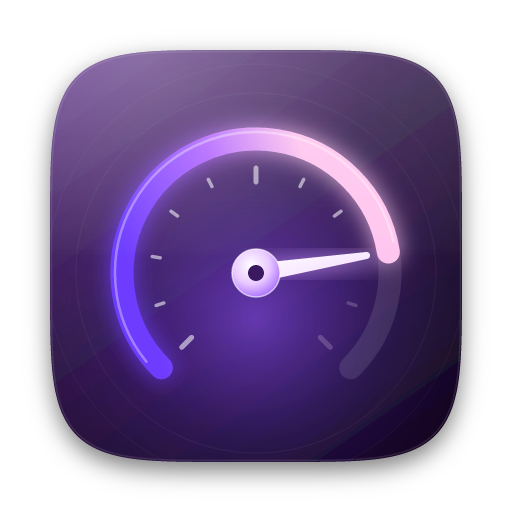
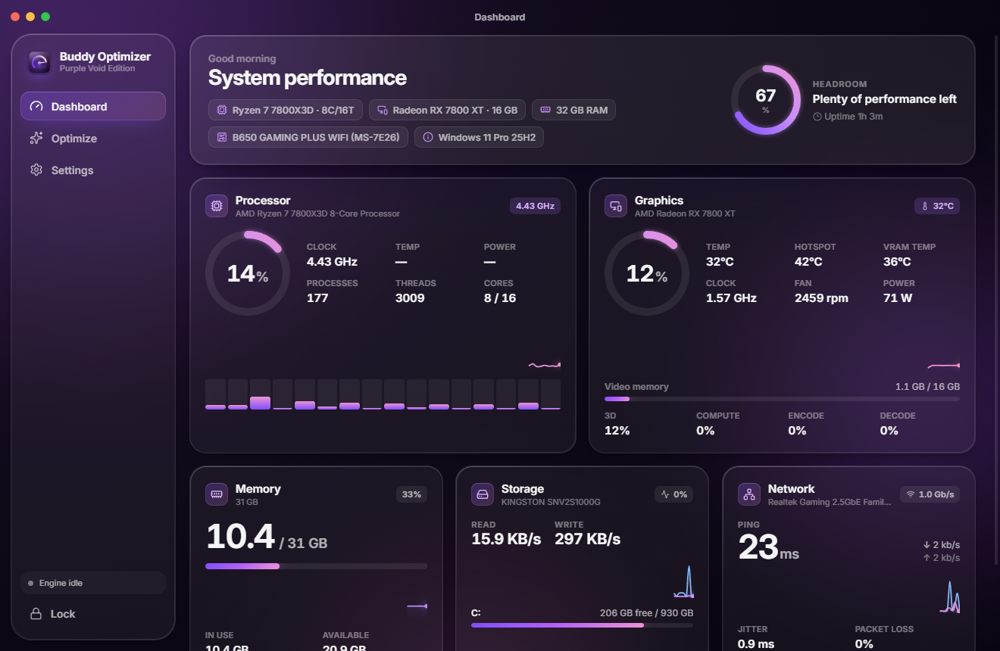
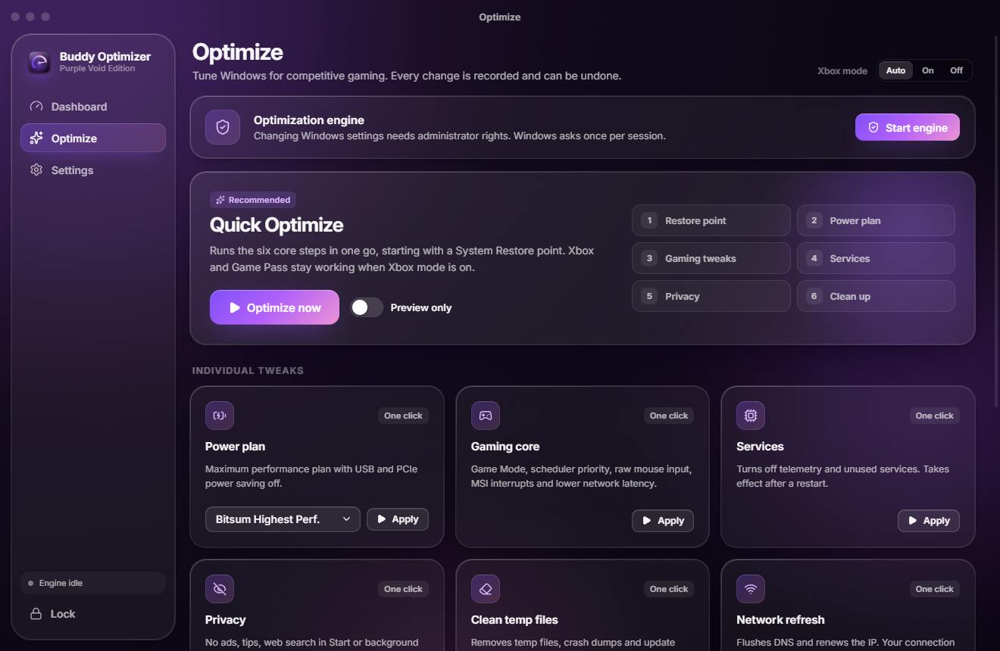
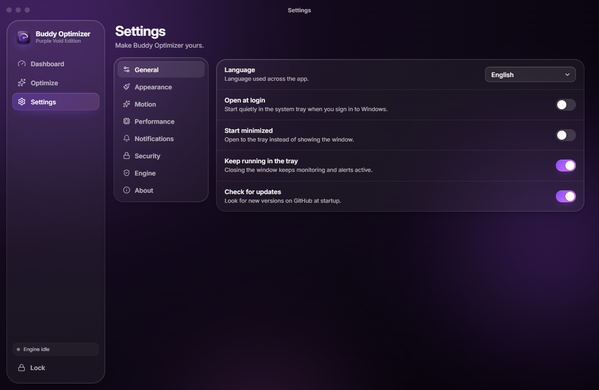

<p align="center">
  
</p>

<h1 align="center">Buddy Optimizer</h1>
<p align="center"><b>A real-time performance monitor and one-click Windows tuner for competitive gaming.</b><br>
Purple Void edition · Windows 10 / 11 · x64 · <a href="https://itzbuddyyy.github.io/buddy-optimizer/">Website</a></p>

<p align="center">
  
</p>

## Features

**Live monitoring.** A panel for each component, updated up to twice a second:

| Panel | What you see |
|---|---|
| Processor | Total and per-thread load, live clock speed, processes and threads, uptime |
| Graphics | Load, core / hotspot / VRAM temperature, clock, fan RPM, board power, VRAM usage, and 3D / compute / encode / decode engines |
| Memory | In use, available, cached and committed memory, plus history |
| Storage | Read/write throughput, activity and free space for each drive (and temperature when available) |
| Network | Download and upload, ping, jitter and packet loss to a server you choose, plus link speed |

**One-click optimization.** Quick Optimize starts with a System Restore point and then tunes six areas:
- **Power:** high-performance power plan
- **Gaming:** Game Mode, scheduler priority, raw mouse input, MSI interrupts and network latency
- **Services:** telemetry and unused services
- **Privacy:** ads, tips and tracking
- **Cleanup:** temporary files
- **Network:** a quick connection refresh

**Per-game optimization.** The **Games** section tunes each game's own settings file:

| Game | What changes |
|---|---|
| Call of Duty: Warzone / Black Ops 7, Modern Warfare 4 | itzBuddy's competitive profiles: low shadows, effects, particles and water; no blur or depth of field; V-Sync off; uncapped FPS; exclusive fullscreen. NVIDIA Reflex or AMD Anti-Lag 2 depending on the GPU; frame generation off; config cloud sync off |
| Fortnite | Performance rendering mode, low scalability presets, 100% 3D resolution, V-Sync and motion blur off, fullscreen |
| Apex Legends | V-Sync, adaptive resolution, shadows, ambient occlusion, ragdolls and ADS blur off, exclusive fullscreen (the file can optionally be locked) |
| VALORANT | Low detail, shadows and effects for every Riot account on the PC, V-Sync off, fullscreen. Anti-aliasing stays as you set it |

Resolution, monitor, refresh rate, audio devices, sensitivity and key binds are never touched. Only keys that already exist in the file are changed, each value is checked against what the game allows, and nothing is written while the game is running. The file is backed up first and **Restore** puts it back exactly. Optionally, the game can be forced onto the dedicated GPU (laptops and dual-GPU PCs) or given high CPU priority. Game files and memory are never modified.

**Tools:** Debloat, startup apps, look & feel, GPU (NVIDIA profile, AMD Adrenalin, driver pages), timer resolution, and advanced switches that each show their trade-off.

**Undo everything.** Every registry value, service start type and command is recorded before it changes. Any session can be rolled back from **Optimize → Repair**.

**Xbox-aware.** Xbox mode keeps Xbox, Game Pass and the Microsoft Store working.

**Other features:**
- Password lock and auto-lock. Only the owner's PC can change the password (see below)
- Threshold alerts (GPU temperature, CPU, RAM, ping)
- Tray mode, launch at login and automatic updates from GitHub Releases
- Five languages: English, Italiano, Español, Français, Deutsch
- Dark and light themes, adjustable glass, macOS- or Windows-style window controls, and three motion levels

<p align="center">
  
  
</p>

## Install

Download `Buddy-Optimizer-Setup-x.y.z.exe` from [Releases](../../releases) and run it.

- The app opens with a password lock. Your distributor gives you the password.
- **Change password** in **Settings → Security** appears only on the owner's PC, which holds a private key file at `%APPDATA%\Buddy Optimizer\owner.key`. The source contains only that key's SHA-256 hash. If you fork the project, generate your own key and replace `OWNER_KEY_SHA256` in `src/main/auth.ts`.
- Monitoring runs **without** administrator rights. The optimization engine asks for administrator rights **once per session**, the first time you optimize something.
- The installer is not code-signed yet, so Windows SmartScreen may show "Windows protected your PC". Click **More info → Run anyway**.

## How it works

```
Electron app (runs as the normal user)
├── Renderer: React + Motion, custom glass UI, sandboxed, no Node access
├── Main process: settings, password lock (scrypt), tray, alerts, updates
├── BuddyMonitor.exe   C# (.NET Framework 4.7.2, built into Windows)
│     Windows performance counters (PDH) for CPU, GPU engines, VRAM, disk and network
│     DXGI for GPU names and VRAM size; LibreHardwareMonitorLib for GPU temperature, fan and power
│     Streams JSON lines; no WMI, no admin rights, no kernel driver
└── engine\Agent.ps1   started elevated on demand (one UAC prompt)
      Talks to the app over a private named pipe (random name + one-time token)
      Runs the itzBuddy PowerShell modules; every change is journaled for undo
```

There is no CPU temperature on purpose. Reading it needs a kernel driver (PawnIO), and some anti-cheats, such as FACEIT, are reported to block that driver. Buddy Optimizer never installs one.

## Build from source

Requirements: Node.js 22+, .NET SDK 8+ (it builds the net472 helper), Windows 10/11 x64.

```bash
npm install
npm run build:native   # BuddyMonitor.exe
npm run build:icons    # icon.ico, installer artwork (from the vector masters)
npm run dev            # run the app
npm run dist           # build release/Buddy-Optimizer-Setup-<version>.exe
```

You can preview the interface in a browser with simulated data: `npx vite --config vite.preview.config.ts`

### Releasing

1. The repository is `itzBuddyyy/buddy-optimizer` (set in `electron-builder.yml` and `package.json`).
2. Bump `version` in `package.json`, commit, then push a tag: `git tag v1.2.0 && git push origin v1.2.0`
3. The **Release** workflow creates a draft release, uploads the installer, its blockmap and `latest.yml` into it, checks that all three are there, and then publishes the release. Installed copies update themselves.

## Project layout

| Path | Contents |
|---|---|
| `src/main` | Electron main process (window, IPC, lock, monitor and engine bridges) |
| `src/preload` | The typed, minimal bridge exposed to the UI |
| `src/renderer` | The interface: views, components, design tokens, translations |
| `native/BuddyMonitor` | C# hardware monitor helper |
| `engine` | itzBuddy optimization engine (PowerShell), also usable on its own via `itzBuddy.cmd` |
| `scripts` | Icon generator (pure vector geometry) and asset build |
| `build` | Icons, installer artwork, NSIS hooks |

## Third-party components

See [THIRD_PARTY_NOTICES.md](THIRD_PARTY_NOTICES.md).

## License

[MIT](LICENSE) © 2026 itzBuddy. Bundled third-party components keep their own licenses.
